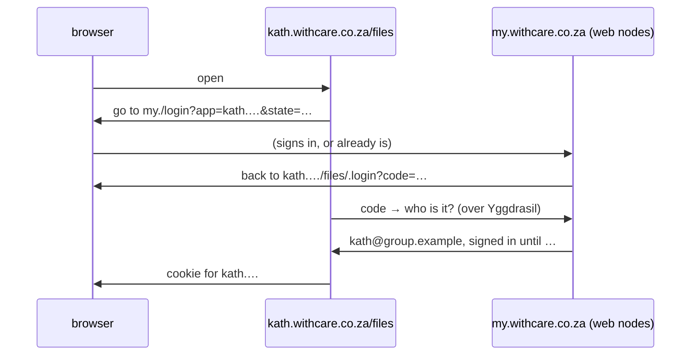

# One login for the group

Status: approved 2026-10-18; steps 1 and 2 built (see [What's built](#whats-built)).
Proposed 2026-11-10: [a new device with numbers from several nodes](#a-new-device-with-numbers-from-several-nodes),
no password.

Everyone in the group, whether a member with their own node or someone on a
box, gets **one login that works everywhere in the group**:
`kath@group.example`. They sign in once at `https://my.withcare.co.za`.
Every page the group serves then knows who they are, without another
sign-in.

It's only for this group: the group is the sole login provider, and only the
group's own addresses can use it. There's no Google and no other group.

## What the person sees

1. A page in the group that needs to know who they are, such as
   `kath.withcare.co.za/files`, sends them to `my.withcare.co.za`.
2. If they're already signed in there, they go straight back, signed in. If
   not, they sign in there as today, with a passkey.
3. **Your devices** lists one sign-in per browser, with the places it's
   used. Signing out there signs that browser out everywhere.

## What can use it

- **Files on the web**, at `my.` and at a person's own address.
- **Writing mail** on the web (step 5 of [web access](web-access.md)), when
  it's built.
- **The ygg page** for people on a box, who have no dashboard of their own
  (see [ygg](ygg.md)).
- **Pages on a site that only the group should see**, e.g. a members'
  page on withcare.co.za.
- **Ordinary apps the group runs**, such as a wiki, chat or calendar on one of
  the nodes. Any app with "Sign in with OpenID Connect" can use it, once the
  admin adds it.

Not the dashboard: a member's dashboard can do everything to their files, so
it stays on Yggdrasil from their own devices, as now.

## How it works

- **The web nodes are the login.** After [always on step 1](web-access.md#always-on)
  they already hold every light client's keys and check sign-ins. This adds
  the members, whose nodes send their keys to the web nodes the same way
  boxes do. It also adds the hand-off to other addresses.
- **It's the usual OpenID Connect code flow,** with PKCE (which stops a stolen
  code being used). The group's own pages and ordinary apps then use the
  same thing, and nothing about it is new to check.
  - `my.withcare.co.za` publishes `/.well-known/openid-configuration` and
    its signing keys.
  - A code works once, within a minute, and only for the app it was made
    for.
  - The app gets an ID token: who, a name, an email if they have a name, and
    the box they're on.
- **Only the group's addresses.** The login sends people back only to an
  address under the group's domain that the web nodes serve, or to an app
  the admin added. Anything else is refused, so no outside site can get a
  login.
- **Always on.** Each web node signs with its own key, and both public keys
  are published, so either one can sign alone. Sign-ins are already shared
  between them. Turning off any one machine stops nobody signing in.
- **Each address keeps its own cookie.** There's no cookie for the whole
  domain, so someone's website can't send a signed-in request to the files
  page on another address. Signing out at `my.` ends every address's
  session for that browser.
- **Removing, suspending or turning off web access** ends the person's
  sign-in and every app's session, as now.

## Keys made before this

Passkeys belong to the address they were made at. So:

- New invites make keys at `my.withcare.co.za`.
- A key made at someone's own address still signs in there. Signing in there
  also signs them in at `my.`, so the rest works.

This undoes part of an earlier decision (2026-10-16), that someone with a
name signs in only at their own address. Their files stay at their own
address; only signing in moves.

## Trade-offs

- **The web nodes now vouch for everyone in every app.** That is already
  true for files after always on step 1. This adds the apps.
- **For now it mainly tidies things.** The only page needing a login today
  is files on the web. It pays off with writing mail, the ygg page and the
  group's own apps.
- **One login is one thing to lose.** A locked or lost key locks the person
  out of everything at once. It's still fixed the same way, with a new
  invite.

## A new device with numbers from several nodes

Status: proposed 2026-11-10. Nothing is built.

Passkeys are safe, but some people find them hard to set up, and a
password is one more thing to remember. This signs in a new device with no
password. The signing in is spread over several nodes, so no one node can
do it alone.

### What the person sees

1. On a new phone or laptop, they type their email address.
2. A few short numbers arrive, each from a different node of the group,
   such as `47`, `12` and `90`. The page says where to look for them.
3. They type any two of them. The device is now theirs: it's remembered,
   and later visits just work.
4. **Your devices** lists it. Removing it there, or the admin removing it,
   signs it out everywhere.

They type numbers once per device, not each time they sign in.

**Signing in must be instant, or this is a step back.** So:

- **Every sign-in after the first is instant:** the device proves itself
  with its key, with no typing and no waiting. That's quicker than a
  password.
- **The first time on a device must take seconds too.** The numbers go
  first where they show at once: a device the person is already signed in
  on, their box's dashboard, their phone. Email, which can be slow or land
  in spam, is the fallback, not the main route.

### How it works

- **Each number comes from its own node,** chosen from nodes on different
  machines: the web nodes, the admin's node, the person's own box. Each
  node makes its number, keeps only that number's hash, and sends it.
- **Two of three is enough,** so one node being off doesn't stop anyone.
- **Each node checks its own number.** The web node the person types into
  passes each number to the node that made it, which answers yes or no.
  Only that node knows whether it's right, so a node can't learn the
  others' numbers.
- **The device makes a key of its own.** The browser makes a key pair that
  can't be copied out of it (WebCrypto, kept in the browser), and sends the
  public half with the numbers. Each node whose number was right **signs
  that public key** for this person.
- **A device is let in with two nodes' signatures.** Every web node keeps
  each person's devices, with the signatures, and accepts a device only
  with two from different nodes. Later visits prove the device by signing
  a challenge with its key, on any web node.
- **So one node can't add a device.** A node that's been broken into, or a
  rogue admin on one machine, has one signature, not two.

### Keeping it safe

- **Limits:** 5 wrong numbers and that request ends; a few requests an hour
  per email address and per visitor, as for passwords now.
- **Numbers last 10 minutes** and are used once.
- **One request at a time:** asking again sends the same numbers again,
  never new ones, at most every few minutes
  ([one email at a time](email-login.md)).
- **Every message says what it's for:** "a sign-in to tutoring.withcare.co.za
  from a new device, from about Johannesburg", so an unexpected one gets
  noticed. Where it seems to come from, from the web node's view, is
  shown as information, never used as a lock.
- **A message that wasn't asked for** has a "this wasn't me" link, which
  ends the request and tells the admin.

### How safe it is depends on the routes

| The numbers go | Someone needs, to get in |
| --- | --- |
| all by email | the person's email |
| by email and to their box (on its screen or dashboard) | their email and their box |
| by email, their box and their phone | two of the three |

Email alone is about as safe as "forgot your password" on most sites.
Different routes make it as strong as a second factor, and it's still
just typing numbers.

### The other way: approve it from a device you have

Instead of numbers, a device the person already uses (their phone, or
their box's dashboard) shows "a laptop wants to sign in as Lee: allow?",
and tapping yes signs the new key. With no other device, the request goes
to the site's admin, who knows them. It's one tap instead of typing, but
an approval tapped without reading lets a stranger in, which typed numbers
make harder. Both can be offered: numbers by default, approval for people
who have a second device.

### Where it fits

- **Passkeys stay.** This is for people without one, and for adding a
  device to someone who has one.
- **The group login at `my.`** gets it as another way to sign in. So do the
  sites' private parts when they move onto the web nodes
  ([apps on the log](site-code.md#apps-on-the-log-the-private-part-on-every-web-node)),
  where a device's signatures are entries like a password hash.
- **A cleared browser loses its key,** and the device signs in with numbers
  again. Nothing else is lost.
- **It protects signing in, not the data.** A web node still reads what it
  serves; this stops one node adding a device, not one node misusing data.

### Questions

1. **Which routes?** They must show at once (see
   [What the person sees](#what-the-person-sees)). A device the person is
   already signed in on is the quickest: the page there shows the number
   as it arrives. A message to a person's box needs a place on the box to
   show it. A phone needs an app or SMS, and SMS is outside the group.
   Email is there today, as the fallback.
2. **Which nodes send numbers?** At least three on different machines, with
   at least two up at any time.
3. **Two digits each, or three?** Two of three two-digit numbers is four
   digits to type. With the limits that's enough; three digits each is
   safer and a little more typing.

## Build order

1. **The login at `my.`**: the hand-off and the OpenID Connect endpoints on
   the web nodes. Files at a person's own address use it.
2. **Members too**: their nodes send their keys to the web nodes, and the
   dashboard gets "make a passkey for the group login".
3. **Apps**: the admin adds an app (name, address); the ygg page and writing
   mail use it as they're built.

## What's built

Step 1, on every web node (`internal/light/login.go`):

| Address on `my.` | What it is |
|---|---|
| `/.well-known/openid-configuration` | discovery |
| `/login/authorize` | the hand-off: a code for a group address, or the sign-in page first |
| `/login/token` | a code and its PKCE verifier for an ID token and an access token (1 hour) |
| `/login/userinfo` | who an access token is for |
| `/login/keys` | every web node's public signing key (ES256) |
| `/login/signout` | signs this browser out at `my.` and at every address it came to from there |
| `/login/adopt` | after signing in at their own address, signs the browser in at `my.` too |

- **At someone's own address**, `/files` signed out goes to `my.` with
  `prompt=none`. Signed in there as that person, it comes straight back
  signed in. Otherwise, or as someone else, it shows the address's own
  sign-in page, as before, and signing in there signs the browser in at `my.`
  as well.
- **Codes and sessions are shared** between the web nodes; a code works once,
  on whichever node it reaches, within a minute. Used codes and ended
  sessions are remembered for a while, so word of them arriving late from
  the other node doesn't bring them back.
- **Who may ask:** `client_id` is a group address under the domain (not
  `my.` itself), and `redirect_uri` an `https` address at that host. PKCE
  (S256) is required. There are no client secrets yet: apps the admin adds
  (step 3) will have them.
- **Claims:** `sub` (`box/person`), `name`, `preferred_username`, `box`, and
  `email` (`label@domain`) for someone with a name under the group's domain.
- **Your devices** shows one sign-in per browser, with the addresses it's
  signed in at.

Step 2, members (2026-11-10, `internal/member`):

- **A member's own node keeps their passkeys**, as a box keeps its people's,
  in `~/.yggstore/member-login.json`. The member is the node's owner in the
  group's list, and their address comes from the node's name
  (`peter.withcare.co.za` gives `peter@withcare.co.za`).
- **`yggstore login invite`**, on the member's machine, asks their node for an
  invite and shows it as a QR code to open on a phone, which makes a passkey
  at `my.` as a box's invite does. `yggstore login keys` lists them and
  `yggstore login forget ID` forgets one, not the last.
- **The node sends the web nodes its member and their keys** once it has made
  an invite, marked as a member's node (`People.Member`). The web nodes then
  pass the member's invite and pages to the node's API, under `/v1/member`,
  instead of to a box's hub; only web nodes may ask there, and only the
  node's own machine may make an invite.
- **Signing in works while the member's node is off,** as for people on a
  box: the web nodes check the passkey. Once signed in, the member's page at
  `my.` says so and links to their devices; their files and dashboard stay
  on their own node.
- **Not on a box:** a node whose machine runs a box's hub refuses, so its
  people's requests keep going to the hub. A box's owner signs in as a
  person on it.
- Not yet: "make a passkey for the group login" on the dashboard; the
  command line does it for now.
