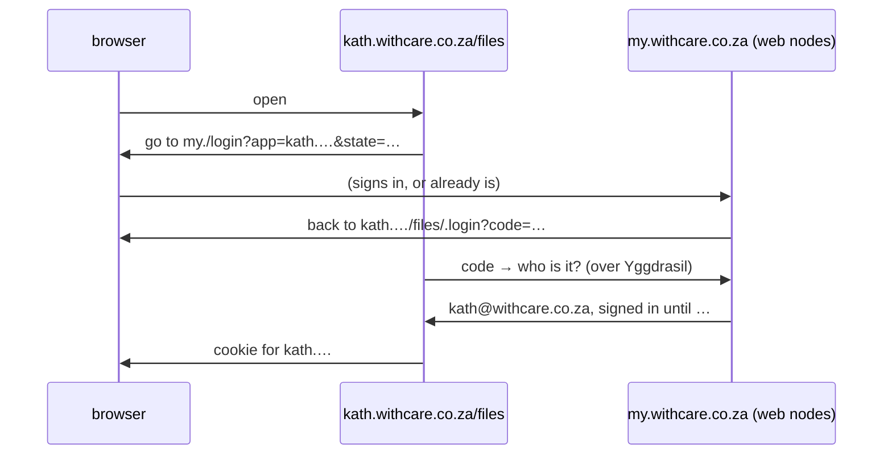

# One login for the group

Status: proposed 2026-10-17, not approved.

Everyone in the group, whether a member with their own node or someone on a
box, gets **one login that works everywhere in the group**:
`kath@withcare.co.za`. They sign in once at `https://my.withcare.co.za`.
Every page the group serves then knows who they are, without another
sign-in.

It's only for this group: the group is the sole login provider, and only the
group's own addresses can use it. There's no Google and no other group.

## What the person sees

1. A page in the group that needs to know who they are, such as
   `kath.withcare.co.za/files`, sends them to `my.withcare.co.za`.
2. If they're already signed in there, they go straight back, signed in. If
   not, they sign in there as today: a passkey, or a browser key and PIN.
3. **Your devices** lists one sign-in per browser, with the places it's
   used. Signing out there signs that browser out everywhere.

## What can use it

- **Files on the web**, at `my.` and at a person's own address.
- **Writing mail** on the web (step 5 of [web access](web-access.md)), when
  it's built.
- **The ygg page** for people on a box, who have no dashboard of their own
  (see [ygg](ygg.md)).
- **Pages on a site that only the group should see**, e.g. a members'
  page on withcare.co.za.
- **Ordinary apps the group runs**, such as a wiki, chat or calendar on one of
  the nodes. Any app with "Sign in with OpenID Connect" can use it, once the
  admin adds it.

Not the dashboard: a member's dashboard can do everything to their files, so
it stays on Yggdrasil from their own devices, as now.

## How it works

- **The web nodes are the login.** After [always on step 1](web-access.md#always-on)
  they already hold every light client's keys and check sign-ins. This adds
  the members, whose nodes send their keys to the web nodes the same way
  boxes do. It also adds the hand-off to other addresses.
- **It's the usual OpenID Connect code flow,** with PKCE (which stops a stolen
  code being used). The group's own pages and ordinary apps then use the
  same thing, and nothing about it is new to check.
  - `my.withcare.co.za` publishes `/.well-known/openid-configuration` and
    its signing keys.
  - A code works once, within a minute, and only for the app it was made
    for.
  - The app gets an ID token: who, a name, an email if they have a name, and
    the box they're on.
- **Only the group's addresses.** The login sends people back only to an
  address under the group's domain that the web nodes serve, or to an app
  the admin added. Anything else is refused, so no outside site can get a
  login.
- **Always on.** Each web node signs with its own key, and both public keys
  are published, so either one can sign alone. Sign-ins are already shared
  between them. Turning off any one machine stops nobody signing in.
- **Each address keeps its own cookie.** There's no cookie for the whole
  domain, so someone's website can't send a signed-in request to the files
  page on another address. Signing out at `my.` ends every address's
  session for that browser.
- **Removing, suspending or turning off web access** ends the person's
  sign-in and every app's session, as now.

## Keys made before this

Passkeys and browser keys belong to the address they were made at, and a
browser key can't move: Kath's lives in `kath.withcare.co.za`'s storage.
So:

- New invites make keys at `my.withcare.co.za`.
- A key made at someone's own address still signs in there. Signing in there
  also signs them in at `my.`, so the rest works.

This undoes part of an earlier decision (2026-10-16), that someone with a
name signs in only at their own address. Their files stay at their own
address; only signing in moves.

## Trade-offs

- **The web nodes now vouch for everyone in every app.** That is already
  true for files after always on step 1. This adds the apps.
- **For now it mainly tidies things.** The only page needing a login today
  is files on the web. It pays off with writing mail, the ygg page and the
  group's own apps.
- **One login is one thing to lose.** A locked or lost key locks the person
  out of everything at once. It's still fixed the same way, with a new
  invite.

## Build order

1. **The login at `my.`**: the hand-off and the OpenID Connect endpoints on
   the web nodes. Files at a person's own address use it.
2. **Members too**: their nodes send their keys to the web nodes, and the
   dashboard gets "make a passkey for the group login".
3. **Apps**: the admin adds an app (name, address); the ygg page and writing
   mail use it as they're built.
