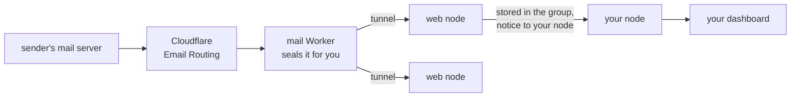

# Email on the group

Get email at your own domain without a mailbox provider. Each message is
encrypted for you as it arrives and stored across the group, so a lost disk
loses no mail.



Incoming mail passes through Cloudflare Email Routing, which hands it to a
small Worker that seals it for your sharing code; from then on only you can
read it. Outgoing mail goes through an SMTP relay. Neither keeps it. Email
itself isn't private: Cloudflare sees each message before it's sealed, and
senders keep their copies. Treat it as ordinary email, stored well.

## Read and write mail

- **On your dashboard:** **Mail** lists your messages; open one to read
  it, download attachments or the whole message (`.eml`), **Reply**, or
  **Write** a new one.
- **In a terminal:** `yggstore mail list`, `yggstore mail read ID`, and

  ```sh
  echo "Hello" | yggstore mail send -to someone@example.net -subject "Hi"
  ```

Messages are plain text, up to 50 recipients, and 60 an hour. A copy of
each goes to **Sent**. A node that was off collects its mail when it's back.

## Use a mail program

The dashboard serves your mailbox to mail programs on the same machine:
IMAP on `127.0.0.1:2143` and SMTP on `127.0.0.1:2587`.

1. Run `yggstore mail bridge`. It prints the settings and the password.
2. In Thunderbird, **Add Mail Account** › **Configure manually**, and enter
   them. Connection security is **None**: Thunderbird warns, but the
   connection never leaves your machine.

You get Inbox, Sent, Drafts, Trash, Archives, Junk and your own folders,
with read and flagged marks. Emptying Trash deletes a message from the
group for good. Use `-imap` and `-smtp` on `yggstore dashboard` to change
the ports (`""` turns one off).

## Addresses for members

Every name the group gives is an address and a website: `anna@example.org`
and `anna.example.org`.

1. The member asks for a name on their dashboard, under **Your name** (or
   the box's admin, **W**, for someone on a box).
2. The admin's dashboard gives it at once if it's free, and puts a report
   in the admin's mailbox ("New website and email: ..."). A taken name is
   declined. Names kept for the group (`admin`, `www`, `postmaster` and
   the like) wait under **Requests** for the admin.
3. Mail to the address arrives in the member's mailbox, and they can send
   as it.

**Take back** on the admin's dashboard ends a name. To decide on every name
yourself, start the admin's dashboard with `-approve-names=false`.

## Mail at a client's own domain

Someone on a box with a [domain of their own](host-a-client.md) has one
mailbox for it: every address at the domain comes to them, and they can send
from any address at it. **Take its mail too** under **Names** on the admin's
dashboard sets it up, and changes nothing if the domain's mail already goes
somewhere else. It needs the relay's token to have Email Sending: Edit. The
domain's DMARC reports come to the admin's address.

## Set up mail for a domain

Once, for the group's admin. You need [web nodes](sites.md#setting-up-web-nodes)
and a domain on Cloudflare whose mail isn't used for anything else.

### Receiving

1. **Make a token for the Worker,** on one web node:
   `yggstore mail token ~/.yggstore/mail-in.token`. Copy the file to the
   other web nodes (same path, private), add
   `-mail-in ~/.yggstore/mail-in.token` to each one's `serve` command, and
   restart them.
2. **Give the Worker a way in:** in Cloudflare, add a published
   application route on the web nodes' tunnel, such as
   `mail-in.example.org` → `http://localhost:8480`.
3. **Give the group the domain:** add `"domain": "example.org"` to the
   admin's entry in `peers.json`.
4. **Deploy the Worker:**

   ```sh
   cd deploy/mail-worker
   cp wrangler.example.jsonc wrangler.jsonc   # set INGEST_URL to https://mail-in.example.org/_yggstore/mail
   yggstore mail token ~/.yggstore/mail-in.token | npx wrangler secret put INGEST_TOKEN
   npx wrangler deploy
   ```

   Addresses not in the file's `MAILBOXES` are looked up from the group's
   names. `wrangler.jsonc` holds real addresses, so it stays out of git.
5. **Send the domain's mail to it:** in Cloudflare, the domain's **Email** ›
   **Email Routing**, turn it on, and route the catch-all to the Worker
   `yggstore-mail`.

Send yourself a message: it shows on your dashboard within a minute.

### Sending

These steps use SMTP2GO; any relay with an SMTP login on port 587 or 465
works.

1. **Verify the domain at the relay:** **Sending** › **Verified Senders**,
   add the domain, and add the DNS records it lists in Cloudflare (DNS only).
   If the domain has no DMARC record, add one:
   `_dmarc TXT "v=DMARC1; p=none; rua=mailto:you@example.org"`.
2. **Give the web nodes a login:** add an SMTP user at the relay, then on one
   web node run `yggstore mail relay ~/.yggstore/mail-out.json` and fill in
   the file:

   ```json
   {
     "smtp": "mail.smtp2go.com:587",
     "user": "…",
     "password": "…",
     "senders": {"you@example.org": "200:…"}
   }
   ```

   `senders` gives addresses outside the group's names to a node
   (`yggstore mail address` prints a node's line). Copy the file to the
   other web nodes (mode 600), add `-mail-out ~/.yggstore/mail-out.json` to
   each one's `serve` command, and restart them.

## When something goes wrong

Every web node on the tunnel needs `-mail-in`, since the tunnel can bring
mail to any of them; one without it warns when it starts, and the admin's
dashboard shows **takes no mail** under **Incoming mail**. Refused addresses
are logged on the web node (`mail: refused`) and counted there.

| You see | Check |
| --- | --- |
| nothing arrives | `npx wrangler tail`: 403 means the tokens differ; 503 means the web node couldn't store it or reach your node (the sender retries) |
| "no web node that sends mail is online" | the web nodes' logs: none has a working `-mail-out` file |
| "this node may not send as …" | the address isn't one of your names, and no `senders` entry gives it to you; entries must match on every web node |
| "the mail relay: …" | the relay's answer, such as a wrong login or an unverified domain |
| "Can't open this message" | it was sealed for another sharing code: `MAILBOXES` must have the code `yggstore mail address` prints here |

A web node logs `mail: took ID for NODE` for each message, and your node
`mail: collected ID`.
