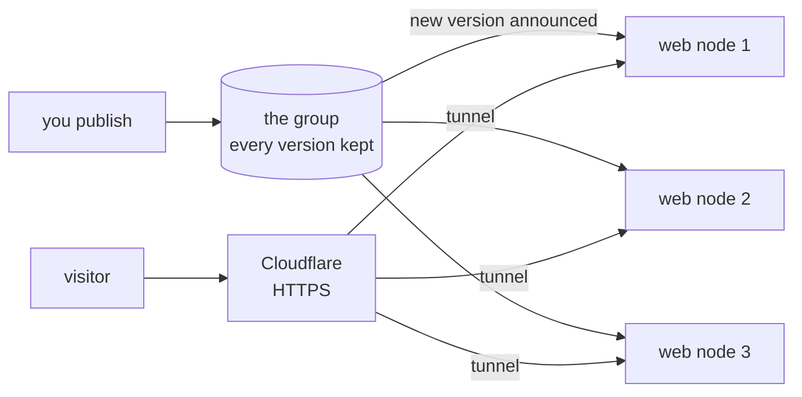

# Websites on the group

Publish a website from a folder and several machines serve it, so it stays
up when one of them is off. Every version is kept, and you can preview the
next one before it goes live.



A site is plain files (HTML, Markdown, CSS, images, JavaScript). It can
also have [code and data](site-code.md) that the web nodes run, and a
[contact form](#a-contact-form).

## Publish a site

Choose the way that suits you; they all store a new version and the web
nodes switch to it within a minute.

- **On a box's network drive**, edit the files in `websites/DOMAIN`. A
  change is published about 15 seconds after you stop editing.
- **On your dashboard**, under **Your website**, **Publish a folder** or a
  zip, or **Edit** single files.
- **From a project on your machine**, `git push` (see
  [publishing with git push](#publishing-with-git-push)).
- **From the command line** on a machine that runs a node:

  ```sh
  yggstore site publish ./example.org
  yggstore site publish ./public -name www.example.org   # a folder with another name
  ```

A web node serves `index.html` (or `index.md`) for a folder, the site's
`404.html` for a missing page, and `www.DOMAIN` as `DOMAIN` unless that is a
site of its own.

A site can only be changed by the machine that first published it, or by an
admin. A site under the group's domain belongs to whoever holds the name.

### Folders that publish themselves

A dashboard that watches an outbox (`-outfiles`), and a box for each of its
people, keeps sites in a `websites/` folder, one folder per domain:

```
websites/
├── example.org/                      the live site: change it here
├── example.org (preview)/            the next version (see Preview)
└── new.example.net/                  a new site
    new.example.net - NOT PUBLISHED.txt   why not yet, and what to do
```

- A change is published if it looks safe: the folder has a home page,
  holds at most 500 MB, and hasn't shrunk to less than half. Otherwise the
  note beside it says why, and the live site stays as it is.
- A new domain is published once it's on Cloudflare; a name the group gave
  you is published at once.
- A site published another way (the dashboard, the command line) is copied
  into its folder, unless you changed the folder meanwhile.
- Deleting a folder doesn't take its site down. Use `yggstore site remove`.

## Preview before going live

Put the next version beside the site's folder, in a folder with
` (preview)` after the name, such as `shop.example.org (preview)`. Or run
`yggstore site preview FOLDER -name DOMAIN`.

1. The preview is published, and the file `… (preview) - LINK.txt` holds
   its link.
2. Open the link. That browser now sees the preview on every page of the
   real address, with a bar at the bottom; everyone else sees the live site.
3. Press **Go live** on the dashboard's website card (`G` in the box's
   admin, or `yggstore site live DOMAIN`). Every web node switches at once,
   and the site's folder gets the new version. **Drop** throws it away.

The link's key never leaves the publishing machine; the web nodes know only
its hash. In a preview, the site's code and data are the live site's.

## Markdown pages

Write pages in Markdown, beside or instead of HTML. They're built into
pages when the site is published:

| In the folder | On the site |
| --- | --- |
| `index.md` | the home page |
| `about.md` | `/about/` |
| `courses/intro.md` | `/courses/intro/` |

- **Layout:** `_layout.html` with `{{title}}`, `{{content}}` and
  `{{site}}`, or a plain built-in one. A page can set `title:` and
  `layout:` between `---` lines at the top; otherwise its title is its
  first `#` heading.
- **Links:** link to a page by its `.md` file (`[Our menu](menu.md)`).
  Pictures beside a page (``) keep working. Headings get ids
  (`## Fish {#fish}`). GitHub's Markdown and HTML both work.
- **Not published:** names starting with `_` or `.` (keep drafts in
  `_drafts/`), `README.md` and `node_modules`. A page wins over a file of
  the same name.

The Markdown source goes with each version, so a site's folder never gets
built pages back in place of its `.md` files.

## Working on a site on your own machine

```sh
yggstore site dev ./shop
```

This serves the folder at `http://127.0.0.1:8484/` exactly as the web nodes
will: Markdown, notices, the 404 page, and the site's `/api/` code with its
data. Saving a file rebuilds it, and open pages reload. The contact form's
messages are printed instead of sent. It needs no node.

Build with whatever you like (Vite, TinyGo) into the folder; the group only
gets the result. Data you create while working stays in
`.yggstore-dev/`, which is never published; delete it to start again.

To work with the live site's data, copy it in first, on the machine that
publishes the site:

```sh
yggstore site data pull shop.example.org ./shop
yggstore site dev ./shop -name shop.example.org
```

The folder's old local data is set aside, and nothing goes back to the
live site.

## Publishing with git push

Set a project up once:

```sh
yggstore site init -name shop.example.org -box http://[200:...]:7480 -build "npm run build" -output dist
```

- `-box` is the box's dashboard address; your machine must be one of its
  owner's devices (the box's admin, **Devices**).
- Leave out `-build` and `-output` for a folder of plain HTML or Markdown.

Then:

| You push | What happens |
| --- | --- |
| `main` (or `master`) | builds here and publishes the result |
| `preview` | builds here and publishes a preview |
| any other branch | nothing |

Only the built folder is sent: no hidden files (`.env`), `node_modules` or
local data. If the build fails, the push stops. `git push --no-verify`
skips publishing once, and `yggstore site push` (`-preview`) publishes
without git.

## A contact form

Turn it on with the **Contact form** box on the dashboard (or
`yggstore site contact DOMAIN on`). The site gets a contact page at
`/_yggstore/contact` and a **Contact** link on its home page. Messages
arrive in your mailbox on the group, sealed for you; no mail relay or form
service sees them.

For a form in your own design, post to the same address:

```html
<form method="post" action="/_yggstore/contact">
  <input type="hidden" name="_next" value="/thanks.html">
  <label>Name <input name="name" required></label>
  <label>Email <input name="email" type="email" required></label>
  <label>Message <textarea name="message" required></textarea></label>
  <input name="_gotcha" style="display:none" tabindex="-1" autocomplete="off">
  <button>Send</button>
</form>
```

- Any fields work. `email` becomes the Reply-To; `_subject` or `subject`
  the subject.
- `_next` is the page shown afterwards. A script posting with
  `Accept: application/json` gets `{"ok":true}`.
- `_gotcha` catches robots: a post with it filled is dropped. So is one
  with a link or HTML in a name, subject or phone field, which no person
  writes there.
- Limits: 64 KiB a message, three from one address an hour, 100 a day per
  site on each web node.

To also get the messages at another address, use **Also send its messages
to** on the dashboard and type in the code sent there.

## Websites for members

Every name the group gives is a website and an address: `anna@example.org`
has `anna.example.org` ([mail](mail.md#addresses-for-members)). Web nodes
take a site under the group's domain only from whoever holds the name, and
stop serving it when the name is taken back. Names get no `www.`.

A box also serves its own sites over Yggdrasil, without Cloudflare, at
`http://[its address]:8480/` (`-site-port 0` turns this off).

## Commands

| Command | What it does |
| --- | --- |
| `yggstore site publish FOLDER` | store and serve a new version |
| `yggstore site preview FOLDER` | store a preview, and print its link |
| `yggstore site live DOMAIN` / `drop DOMAIN` | the preview goes live, or away |
| `yggstore site versions DOMAIN` | the versions, newest first |
| `yggstore site rollback DOMAIN [ID]` | serve an earlier version again |
| `yggstore site list` | sites published from this machine |
| `yggstore site status` | which web nodes serve which version |
| `yggstore site announce` | tell the web nodes about every site again |
| `yggstore site remove DOMAIN -yes` | stop serving it and delete every version |
| `yggstore site dev FOLDER` | serve a folder on this machine |
| `yggstore site data pull DOMAIN FOLDER` | copy a site's live data to a folder |
| `yggstore site init` / `push` | publish from a project with `git push` |

The publishing machine keeps each site's versions in `~/.yggstore/sites/`.
Back it up with your stubs.

## Setting up web nodes

Once, for the group's admin.

1. **Choose two or three machines in different places** and add
   `-web 127.0.0.1:8480` to each one's node command:

   ```sh
   yggstore serve ... -web 127.0.0.1:8480
   ```

2. **Create a Cloudflare tunnel** (Zero Trust → Networks → Tunnels, type
   Cloudflared, named `group-sites`) and copy its token.
3. **Give the token to each web node**, readable only by the node's user:

   ```sh
   (umask 077; nano ~/.yggstore/group-sites.token)
   yggstore serve ... -web 127.0.0.1:8480 -web-tunnel ~/.yggstore/group-sites.token
   ```

   The node runs `cloudflared` itself, only while its web server answers,
   so a stopped web node never takes visitors. Don't also run the tunnel as
   a separate service.
4. **Let publishing add each site's route and DNS record:** create a
   Cloudflare API token (Account › Cloudflare Tunnel › Edit, Zone › Zone ›
   Read, Zone › DNS › Edit) and save it in `~/.yggstore/cloudflare-api.token`
   on the publishing machine. Without it, add a published application route
   (the domain → HTTP `localhost:8480`) by hand for each site.
5. **For members' names**, add one route for all of them:
   `yggstore site route '*.example.org'`.

A domain must be on Cloudflare (added there, with its nameservers changed)
before its site can go online. A web node added later needs
`yggstore site announce` once on each publishing machine.

## Checking it works

```sh
yggstore site status                                  # each web node's version and tunnel
curl -H 'Host: example.org' http://127.0.0.1:8480/    # on a web node
```

Stop one web node and reload the site: it keeps loading from the others.
