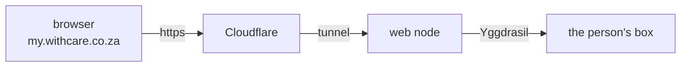

# Light clients: people on a box, through the web

People on a box use their files, website and mail in a browser, at an
ordinary `https://` address, with nothing to install: no Yggdrasil, no
Syncthing, no node of their own.

## Sign in

1. **The box's owner adds the person** (the box's admin, **People**, **A**;
   or **People on this box** on its dashboard). Either:
   - with the person at the box, they type their own password there (**C**);
   - or the box shows a temporary password, such as `milk-salt-jar-962`,
     to give them by phone or in person, never by email. It works for a
     week.
2. **The person signs in** at `https://my.withcare.co.za`, or at their own
   address (`https://kath.withcare.co.za/files`) if they have a name, with
   their email address (or `name@box` without a name) and password. A
   temporary password must be changed at once, to one of at least 10
   characters.
3. **Their page opens:** their files (browse, upload, download, rename,
   delete), their mail, and **Your website** if they have a name.

A session lasts 30 days unused. They see their signed-in browsers under
**Your devices** and can sign any out.

## How it works

- The web nodes serve `my.` and the group's domain through the group's
  tunnel, and pass each request on to the person's box over Yggdrasil.
- The box takes such requests only from the group's web nodes, known by
  their Yggdrasil addresses. It's the same page people get over Yggdrasil.
- At a person's own address, `/files` goes to their box and the rest is
  their website. Only that person can sign in there.

## Passwords

- The box keeps each password as a salted PBKDF2-SHA256 hash, and sends
  the hash to the web nodes, which check sign-ins. So signing in works
  while the box is off, except for choosing a new password.
- A new temporary password ends the old one and every browser it signed
  in: that is how someone who forgot theirs gets back in.
- Five wrong passwords in a row make that person wait 15 minutes; one
  address may try 20 sign-ins in 10 minutes. A wrong address and a wrong
  password get the same answer.

## Without a screen lock

A password works on any device, with or without a screen lock. Keys kept
in one browser, with a PIN, were tried and removed on 2026-10-23.

## Always on

No one machine being off stops anyone signing in or reaching their files:

- **Sign-in is on the web nodes.** Every web node keeps each person's
  sign-in details and sessions, shared among them, so signing in works
  while any one is up.
- **Every person has a recovery copy** of their folder in the group, kept
  by their box ([recovery](recovery.md)).
- **When the box is off,** the web node opens the recovery copy instead,
  and says so. The person can browse, download, upload and change files;
  changes wait, and the box makes them within 20 seconds of being back.
  The copy's key is in two halves: the web nodes hold one, and the
  person's browser the other (a `Secure`, `HttpOnly` cookie), so the web
  nodes alone can't open it. A browser that never opened its files while
  the box was on has no half, and is told the box isn't answering.

## Privacy and safety

- The connection is encrypted all the way, but Cloudflare and the web node
  see what passes through: the files being opened or uploaded, and
  messages. Files are still stored encrypted. Anyone who wants the direct
  route can use Yggdrasil instead.
- The web nodes check sign-ins and carry sessions, so they must be
  machines the group trusts, as they already are for its sites and mail.
- At their own address, a person's website shares an address with their
  files, so a script on their site could act on their files while they're
  signed in. Be careful with scripts copied from elsewhere.
- Uploads go in pieces of up to 32 MB (Cloudflare refuses bigger
  requests), so any size works.

## For developers

- `internal/light`: the web node's relay and sign-in pages; `light.Store`
  keeps people's records, sent by their boxes (`PUT /v1/light/people`).
- `internal/hub/light.go`: on the box, requests from the group's web nodes
  (`X-Yggstore-Relay`, `X-Yggstore-Person`) open the files page.
- `internal/password`: the hashes and temporary passwords.
- A group whose domain has no wildcard record needs a DNS record and
  tunnel route for `my.`, as for a site.
