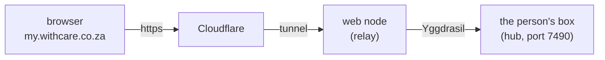

# Light clients: people on a box, through the web

Status: approved 2026-10-16. Steps 1 to 4 are built; writing mail (5) and the later steps are not.

Most people on a box are **light clients**: they want files, a website and
email, and nothing to install. Everything they do goes through their box,
and they use it in a browser, at an ordinary `https://` address, with a
passkey instead of a password. They don't install Yggdrasil or Syncthing,
and they have no node, dashboard or wallet; the box's owner looks after
those.

Today someone on a box must install Yggdrasil on every device to open their
files. That becomes the advanced, direct route, for people who want it.

## What the person sees

1. **The box's owner adds them** under People on this box, as now. The
   invite link is an ordinary web address:
   `https://my.withcare.co.za/join?t=…`. It works once, for a week.
2. **They open it in any browser,** on their laptop or phone. The page
   asks them to name the device and **make a passkey**: the device's
   fingerprint, face or screen-lock PIN. There's no password to choose.
3. **Their files open,** on the same page box people have today: browse,
   upload, download, rename, delete, and their website and messages if
   they have a name.
4. **Next time** they go to `https://my.withcare.co.za` and press **Sign
   in**. The browser offers their passkey.
5. **Another device:** passkeys made on a phone or laptop often sync to
   the person's other devices (Apple, Google and Microsoft accounts do
   this). If not, they press **Add a device** on a device already signed
   in, which shows a one-time link to open on the new one, valid for 15
   minutes.
6. **Lost every device:** the box's owner sends a new invite. Later,
   perhaps a code by email to an address they already read.

## How it works

- **One address for the group:** `my.` and the group's domain, served by
  the web nodes through the same Cloudflare tunnel as the group's sites.
  It's its own address, not the person's website, so nothing on a website
  can reach a signed-in session.
- **The web node only relays.** It passes each request on to the person's
  box over Yggdrasil, and the answer back. It keeps nothing.
- **The box does the signing in.** It keeps each person's passkeys (only
  the public half, in its state file), checks each sign-in, and gives the
  browser a session cookie (`Secure`, `HttpOnly`, `SameSite=Lax`, so the
  link in an email still opens signed in; every action also needs a
  header other sites can't send), good for 30 days of use. The person sees their signed-in browsers under **Your
  devices**, beside their Yggdrasil devices, and can sign any of them out.
- **Which box:** the invite link names the box. The passkey carries the box
  and the person in its user handle, which the browser sends back when
  signing in, so the web node knows where to relay. After that a cookie
  says which box.
- **The box only takes relayed requests from the group's web nodes,**
  known by their Yggdrasil addresses, as it already does for the recovery
  link. Everything else still needs a device let in over Yggdrasil.
- **It's the same page** as over Yggdrasil: one set of code, so files,
  website, messages and (later) writing mail all work both ways.

## At their own address

Someone on a box who has a name in the group (see
[hub.md](hub.md#a-website-and-email-address-for-someone-on-the-box)) signs
in at their own address instead: `https://kath.withcare.co.za/files`.
Their invite link uses it too. Decided 2026-10-16.

- The web nodes send `/files` on that address to the person's box; the
  rest of the address is still their website.
- A passkey made there works only there, and only that person can make
  one or sign in there: someone else's invite or passkey is refused at it.
  A session started there counts only there.
- People without a name keep using `my.` and the domain.
- **The trade-off:** their website and their files share one address, so a
  page they put on their own site could act on their files while they're
  signed in. That's fine for pages they wrote; it's a reason to be careful
  with scripts copied from elsewhere.

## What the box's owner sees

On each person's row under People on this box:
- the invite now gives the web link, with the Yggdrasil one under
  "Advanced";
- their passkeys and signed-in browsers, and when each was last used;
- **Web access** on or off for that person (on by default);
- Suspend and Remove sign every session out at once.

## Privacy and safety

- **Passkeys can't be phished or guessed.** A passkey only works on
  `my.withcare.co.za`, and nothing secret is typed, so a fake site gets
  nothing.
- **What passes through:** over the web, the connection is encrypted from
  the browser to Cloudflare, from Cloudflare to the web node, and from the
  web node to the box, but Cloudflare and the web node see what passes
  between them: the files being opened or uploaded, and messages. Files are
  still stored encrypted in the group either way. The page says this, and
  anyone who wants the direct route can use Yggdrasil instead.
- **A web node can't sign in as someone:** it can't make a passkey's
  signature. But it carries session cookies, so the web nodes must be
  machines the group trusts, as they already are for the group's sites and
  mail.
- **Limits:** sign-in attempts and invite opens are rate-limited per
  address and per person; sessions end after 30 days unused, or at once
  when signed out, suspended or removed.

## Limits

- **Uploads go in pieces** of up to 32 MB, as the recovery link's page
  already does, because Cloudflare refuses a single request over 100 MB.
  Any size still works.
- **The box must be on.** Unlike the recovery link, which works from the
  person's recovery copy, this is the box's own page. When the box is off
  the page says so. (The recovery link stays, for when a box is gone.)
- **It's for people on a box.** Members with their own node keep their
  dashboard, over Yggdrasil.
- **At home too,** a light client uses `my.withcare.co.za`: the request
  goes out to Cloudflare and back to the box. Browsers only allow passkeys
  on `https://` pages, so the box's plain `http://` page on the LAN can't
  sign them in. Later the box could get a certificate of its own for a
  name like `localbox-003.withcare.co.za` pointing at its LAN address
  (Cloudflare's DNS makes that possible), so traffic at home stays at
  home.

## How it's built

- `internal/passkey`: checking passkeys with the standard library only.
  The browser gives the public key in the usual form
  (`getPublicKey()`), so no CBOR is needed; attestation isn't checked,
  since only an invite can make a passkey. Challenges carry their time, so
  a web node can make one a box will take, each good once for 5 minutes.
- `internal/light`: the web node's relay (`Relay`, serving `my.` and the
  domain for `site.Web`), and the sign-in and invite pages. A passkey's
  user handle is the box's name and the person's, which is how a web node
  routes a sign-in from a browser it hasn't seen.
- `internal/hub/light.go`: on the box, requests with `X-Yggstore-Relay`
  from one of the group's web nodes (by Yggdrasil address) are light
  clients': `/files/join` makes a passkey with an invite, `/files/light/…`
  signs in and out, and a session opens the same files page. Passkeys and
  sessions are kept in the hub's state file.
- Big uploads go in 32 MB parts (`X-Part`) when the page is on `https`.
- For withcare.co.za, the domain's wildcard record already sends
  `my.withcare.co.za` through the tunnel to the web nodes. A group without
  one needs a record and tunnel route for `my.` added, as for a site.

## Build order

1. **The relay:** web nodes serve `my.` the group's domain and pass
   requests to a box over Yggdrasil. The box accepts relayed requests from
   web nodes only. The DNS record and tunnel route are added the same way
   as for sites.
2. **Passkeys and sessions on the box:** making a passkey from the invite,
   signing in, sessions, signing out, and listing them under Your devices.
3. **The web invite:** People on this box gives the web link, and the
   person's row shows their passkeys and sessions, with Web access on/off.
4. **Uploads in pieces** on the files page.
5. **Writing mail:** write and reply from their own address, on their
   page, through the group's mail relay. This works over Yggdrasil too.
6. **Later:** signing back in with a code by email; and a box that's off
   showing the person their recovery copy instead.

## Decided (2026-10-16)

- **The address** is `my.` and the group's domain: `my.withcare.co.za`.
- **Web access is on by default** for new people; the box's owner can turn
  it off for someone.
- **Sessions** last 30 days of use.
- **Lost every device:** for now, a new invite from the box's owner. A code
  by email may come later, if people want it, knowing it makes their email
  account the key to their files.
