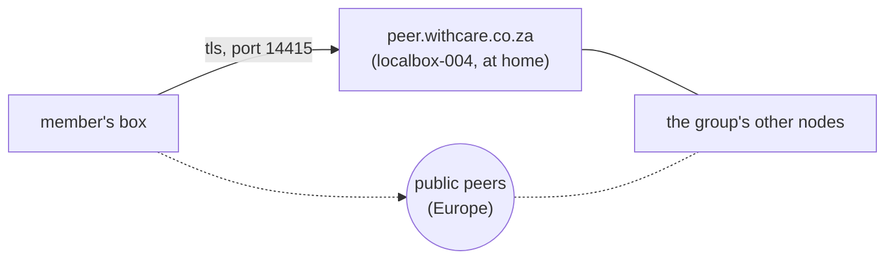

# Members on Yggdrasil only

Tailscale is the admin's way into every box: SSH and sudo, and a few fast
links between boxes. Anyone on the tailnet can reach machines that only the
admin should. So the tailnet stays for the admin, and everyone else joins
the group over Yggdrasil alone.

yggstore itself never needs Tailscale. Files, websites, mail, messaging and
the dashboards all work over Yggdrasil. So this is mostly about how a new
box is set up and how the admin reaches it, plus two small changes.

## Who is where

| Who | Tailscale | Yggdrasil |
| --- | --- | --- |
| The admin's devices | yes, everything | yes |
| Boxes the admin looks after | yes, so the admin has a second way in | yes |
| A member's own box (Yggdrasil only) | no | yes, through peer.withcare.co.za and the group's other links |
| People on a box (Kath, Alexander) | no | not needed: a browser at `name.withcare.co.za/files`, and Syncthing to their box |
| Tim | yes, mail on localmail only | not needed |

Tim stays on the tailnet because his mail reaches localmail that way. Since
2026-10-25 the tailnet's policy lets his devices reach only localmail's mail
ports (110, 143, 465, 587, 993, 995, 25), and its tests check that SSH and
the other boxes are refused.

People on a box already need nothing more. Syncthing finds their box on
the LAN, or through its own relays when they're away, and the browser
reaches their files through the web nodes. Only a machine that runs a node
has to be on Yggdrasil.

## How a Yggdrasil-only box reaches the group



- **First choice: peer.withcare.co.za.** localbox-004 listens on port 14415
  behind the home router. It's a few milliseconds from anywhere in South
  Africa on fiber.
- **Fallback: the public peers** in Europe that the group already lists
  (`ygg_peers` on the admin's entry). They're slow (150 ms and more) but keep
  the box in the group when the home line is down.
- **Later: a second entry point** on the xneelo VPS, so a power or internet
  cut at home doesn't push everyone onto the European peers.

The admin reaches the box by SSH over Yggdrasil, as pi3 (localbox-003) is
reached today. The box's firewall lets SSH in over Yggdrasil only from the
admin's desktop.

## What gets built

### 1. Hand out the entry point through the member list

The mesh ([mesh.md](mesh.md)) already links every node to the addresses
members list as `ygg_listen`, and invites hand those to newcomers first. Nobody
lists one yet. Add 004's:

```sh
yggstore mesh set localbox-004 tls://peer.withcare.co.za:14415
```

Then every node links to it within a minute, and new boxes get it in their
invite without anyone editing their `yggdrasil.conf`. The links set by hand
on localmail and localbox-003 on 2026-10-25 can then be removed.

Check first that the mesh is running on each node: it needs access to
Yggdrasil's admin socket (mesh.md, step 1). `yggstore mesh` shows it.

### 2. 004's allow list follows the member list

localbox-004 lets only the group's own machines link to it
(`AllowedPublicKeys`), so strangers can't route through the home line. Today
that list is typed in by hand, so a new box is refused until someone adds its
key.

A small job on 004, once a minute, like the dashboard firewall:

- It reads the member list and works out every node's Yggdrasil key, from its
  address.
- If that differs from `AllowedPublicKeys`, it rewrites the list and restarts
  Yggdrasil. The restart drops every link for a few seconds, so it happens
  only when the list really changed.
- It never removes the admin's desktop, and it leaves the file alone if the
  member list can't be read.

`yggstore mesh` already prints the `AllowedPublicKeys` line for the group, so
the job only has to compare and write it.

### 3. Set up a box without Tailscale

`scripts/provision-pi.sh` already sets up Yggdrasil from the invite's peers
and doesn't install Tailscale. Two additions:

- It adds the box's SSH rule: over Yggdrasil, only from the admin's desktop.
- It prints the box's Yggdrasil address, for the admin's `~/.ssh/config`
  and for `scripts/deploy.sh`.

`deploy.sh` reaches machines by their SSH name, so nothing changes there
beyond the new entry in `~/.ssh/config`.

### 4. Try it

Try it first on a box at home, where a mistake is easy to fix. That's
localbox-002, which runs only yggstore:

1. Turn Tailscale off on it (don't log out, so it can come back).
2. Check that it stays in the group, its dashboard opens from the desktop,
   SSH and a deploy work, and it reconnects after a restart.
3. Unplug the home internet for a minute and check that it goes back to the
   group through the public peers. Then check it goes back to 004 afterwards.

Then use it for the next member's box.

## What it costs

- **The admin's second way in is gone** for a Yggdrasil-only box. If its
  Yggdrasil stops working, someone on site has to restart it or plug in a
  screen. That doesn't go against [always on](web-access.md#always-on): people still
  reach their files and sites through the other boxes, the web nodes and the
  sealed copies in the group.
- **The home line becomes the group's main entry point** until the second one
  exists. When it's down, members fall back to Europe and get slow, but stay
  connected.
- **A public port at home.** Only the group's keys may link (step 2), and the
  dashboards already turn away anyone who isn't a member or an allowed device.

## Build order

1. `ygg_listen` for 004 in the member list, after checking the mesh runs on
   every node. No code. **Done 2026-10-25:** every node links to 004 through
   it. 004's allow list was brought up to the mesh's list by hand (the test
   nodes t1–t5 and gw were missing; backup
   `yggdrasil.conf.bak-before-mesh-keys`). The links set by hand on localmail
   and localbox-003 are left in place: the mesh sees them as up and adds
   nothing.
2. The allow-list job on 004, with a test that a new member's key gets added
   and a stranger's doesn't. **Built 2026-10-25:** `yggstore mesh allow`
   and the timer in `deploy/mesh-allow` (see [mesh.md](mesh.md#keeping-allowedpublickeys-in-step)).
   Running on 004 since 2026-10-25 (timer each minute).
3. The SSH rule and printed address in `provision-pi.sh`. **Built 2026-10-25:** step 3d
   of the script loads `/etc/yggstore/yggdrasil-in.nft` at every boot (its
   own table, so other rules are left alone), and the script ends with the
   box's `~/.ssh/config` entry. Not yet tried on a real box.
4. The trial, on localbox-004 instead of 002 (the admin's choice). **Started
   2026-10-25:** Tailscale is down on 004 (`tailscale down`; `tailscale up`
   brings it back). SSH, the mesh, the dashboard and the websites it serves
   all work over Yggdrasil. Still to do: a restart, and an hour without the
   home internet. The same day, localbox-003 got the step-3d firewall (it
   had none; SSH over Yggdrasil was open to anyone).
5. Later: the second entry point on the xneelo VPS, added the same way as in
   step 1.
